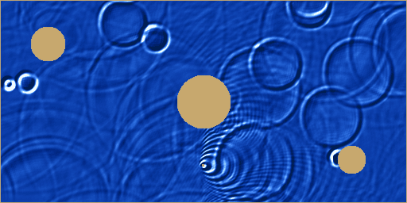

# Волны на воде: 2D волновое уравнение в реальном времени

Вехов Владимир

Задания курса [llvm_course](https://github.com/lisitsynSA/llvm_course):

1. Программа на C, которая в реальном времени рисует динамическую картинку
   через графический интерфейс `sim.h` (`simPutPixel`, `simFlush`, `simRand`).
2. [Инструментирующий LLVM Pass](#задание-2-трасса-user---operand): трасса
   использования IR-инструкций (User <- Operand) в рантайме и
   [статистика частых паттернов](stats/STATS.md).



## Что моделируется

Бассейн с тремя островами. По поверхности воды распространяются волны,
описываемые двумерным волновым уравнением с затуханием:

$$\frac{\partial^2 h}{\partial t^2} = c^2 \left(\frac{\partial^2 h}{\partial x^2} + \frac{\partial^2 h}{\partial y^2}\right) - \gamma \frac{\partial h}{\partial t}$$

Источники волн:

- **дождь** — случайные капли (`simRand`) в случайных точках;
- **пульсирующий источник** (красная точка), который движется по эллипсу.
  Его скорость близка к скорости волн, поэтому хорошо виден **эффект Доплера**:
  впереди источника гребни сжаты, позади — растянуты.

Волны отражаются от бортов и островов и интерферируют друг с другом.

## Численная схема

Явная конечно-разностная схема на сетке 512×256 (клетка 3×3 пикселя),
два слоя по времени:

```
h_new[i] = (h[i-1] + h[i+1] + h[i-W] + h[i+W]) / 2 - h_old[i]
h_new[i] -= h_new[i] >> DAMP_SHIFT          // затухание
```

Это дискретизация уравнения с `c² = 1/2`, что удовлетворяет условию
Куранта для 2D (`c·dt/dx ≤ 1/√2`), так что схема устойчива.
Суша задаётся маской `water[]` (`-1` — вода, `0` — суша), и граничное условие
`h = 0` на суше применяется без ветвлений: `h_new[i] &= water[i]`.

Цвет воды — освещение по наклону поверхности (разность соседних высот)
плюс вклад высоты. Движение источника по эллипсу считается целочисленно
по алгоритму Минского (поворот точки в fixed-point 16.16), без `sin`/`cos`.
Перерисовываются только клетки, цвет которых изменился с прошлого кадра.

## Соответствие требованиям

| Требование | Как выполнено |
|---|---|
| Единственный header в модуле — `sim.h` | `app.c` включает только `sim.h` |
| Нет событий и объектов графической библиотеки | только `simPutPixel` / `simFlush` / `simRand` |
| Типы одного размера | вся арифметика в `int` (32 бита), без `float`/`double`/`char`/`long` |
| Одна точка входа `void app()` | да |
| Нет динамической памяти | все буферы — локальные массивы на стеке в `app()` (~2 МБ) |
| Нет своих структур и `switch-case` | да |
| Нет синхронных внешних событий | не используются `simHasClick` / `simGetClick` |
| Оптимизированный LLVM IR | [`app-opt.ll`](app-opt.ll), `clang -O2` |

## Сборка и запуск

```sh
sudo apt install clang llvm libsdl2-dev

make app          # clang -O2 app.c start.c sim.c -lSDL2 -o app
./app

make app-opt.ll   # clang -O2 -S -emit-llvm app.c -o app-opt.ll
```

Запуск через интерпретатор LLVM:

```sh
make full.bc
lli --load=/usr/lib/x86_64-linux-gnu/libSDL2.so full.bc
```

## Параметры

Все параметры — макросы в начале `app.c`: размер клетки `SCALE`, затухание
`DAMP_SHIFT`, частота и сила капель `RAIN_*`, период пульсации и траектория
источника `SRC_*`, `ORBIT_*`.

## Задание 2: трасса User <- Operand

### Что делает пасс

[`pass/UseTracePass.cpp`](pass/UseTracePass.cpp) — плагин для нового
менеджера пассов. Он подключается через `registerOptimizerLastEPCallback`,
то есть работает с уже оптимизированным `-O2` IR (тем же, что в
[`app-opt.ll`](app-opt.ll)). Пасс применяется только к `app.c`:
`start.c`, `sim.c` и логгер собираются без него.

Перед каждой инструкцией, кроме `phi`, пасс вставляет вызов
`traceUse("<User> <- <Operand>")` на каждый её операнд, который сам является
инструкцией. Аргументы функций, константы, глобальные переменные и метки
блоков в трассу не попадают. Одна и та же запись — одна глобальная строка
в модуле, поэтому в рантайме запись однозначно определяется указателем.

**Задание со звёздочкой.** При `TRACE_PHI=1` операнд-`phi` заменяется на
инструкции из операндов этого `phi` (рекурсивно, если там тоже `phi`;
константы пропускаются). Пример из `drawFrame` — счётчик внутреннего цикла:

```llvm
%18 = phi i64 [ 0, %6 ], [ %68, %67 ]     ; %68 = add nuw nsw i64 %18, 1
%19 = add nuw nsw i64 %18, %8             ; %8  = shl nuw nsw i64 %7, 9
```

| Режим | Записи для `%19` |
|---|---|
| базовый | `add <- phi`, `add <- shl` |
| с раскрытием phi | `add <- add`, `add <- shl` |

### Рантайм и анализ

[`pass/trace_log.c`](pass/trace_log.c) получает записи в порядке выполнения и:

1. пишет начало трассы (первые 200 000 записей) в `stats/*_trace.txt`;
2. на лету считает паттерны: окна длиной от 1 до 5 подряд идущих записей,
   скользящих с шагом 1;
3. сохраняет все счётчики в `stats/*_ngrams.csv`.

Полная трасса за 20 кадров — около 211 млн записей (несколько гигабайт
текста), поэтому паттерны считаются в памяти. Корректность онлайн-подсчёта
проверена: на первых 3 млн записей он совпадает с независимым пересчётом
на Python по текстовой трассе.

[`pass/report.py`](pass/report.py) строит из CSV отчёт
[`stats/STATS.md`](stats/STATS.md): топ-20 паттернов для каждой длины окна,
для обоих режимов.

### Сборка и запуск

Нужны заголовки LLVM (`llvm-config --includedir`), например пакет `llvm-18-dev`.

```sh
make build/libUseTracePass.so      # сам пасс
make build/app-trace.ll            # инструментированный IR (посмотреть вставки)

make app-trace && ./app-trace      # с окном SDL, трасса пишется во время работы
make app-trace-phi && ./app-trace-phi

make stats                         # без окна, фиксированный seed, 20 кадров,
                                   # оба режима + stats/STATS.md
make stats OPT=-Os FRAMES=50       # другой уровень оптимизации / длина прогона
```

Переменные окружения логгера: `TRACE_OUT` (префикс файлов), `TRACE_DUMP`
(сколько записей писать в текст), `TRACE_LIMIT` (после скольких записей
сохранить статистику; при запуске с окном по умолчанию 300 млн, это около
27 кадров).

### Результаты (`-O2`, 20 кадров)

| | Базовый режим | С раскрытием phi |
|---|---:|---:|
| Записей в трассе | 211 011 418 | 212 414 453 |
| Разных записей (окно 1) | 91 | 81 |
| Разных паттернов, окно 5 | 473 | 473 |
| Доля топ-10, окно 1 | 52.7% | 54.8% |

Трасса очень регулярная: вся работа идёт в нескольких горячих циклах,
и на 211 млн окон длины 5 приходится всего 473 разных паттерна.

**Выводы:**

- **Адресация и загрузка из памяти — около трети трассы.** Четыре записи
  `load <- getelementptr` (12.1%), `getelementptr <- getelementptr` (7.9%),
  `add <- load` (7.2%) и `getelementptr <- add` (4.7%) вместе дают 31.9%.
  Самый частый длинный паттерн —
  `getelementptr <- getelementptr | load <- getelementptr`, повторённый
  2–3 раза. Это загрузки соседей `h[i±1]`, `h[i±W]` в `waveStep` и
  `waterColor`: адрес соседа считается как GEP со смещением от GEP текущей
  клетки.
- **Сумма четырёх соседей** видна как `add <- load` ×4 подряд (3.1 млн раз).
  Это шаблон «крест» разностной схемы.
- **Каноническая форма цикла:** `add <- phi | icmp <- add | br <- icmp`
  (инкремент, сравнение, переход) — 1.6% всех окон длины 3.
- **Проверка попадания в круг**, встроенная в `drawFrame`:
  `trunc <- phi | sub <- trunc | mul <- sub | mul <- sub | add <- mul | add <- mul | icmp <- add | select <- icmp`.
  Её паттерны встречаются ровно 2 621 440 раз = 512 × 256 клеток × 20 кадров,
  то есть по одному разу на клетку за кадр.
- **Ограничение `clamp255`** даёт `select <- icmp` (2.4%), а его результат
  сразу идёт в `s * s * s` в `waterColor`: `mul <- select` (3.5%).
- **Что меняет раскрытие phi.** В базовом режиме 6.8% записей имеют операнд
  `phi`. После раскрытия они переходят в реальные источники значений:
  - `add <- add` растёт с 5.2 до 11.7 млн — это счётчики циклов
    `i = i + 1`, которые проходят через `phi`;
  - `getelementptr <- alloca` растёт с 0.7 до 3.5 млн — `phi` выбирает между
    стековыми буферами `bufA`/`bufB` при обмене `cur`/`prev`;
  - `trunc <- add` растёт с 0.4 до 3.3 млн — `trunc` счётчика цикла.

Кандидаты на объединённые инструкции, если проектировать ISA под это
приложение: загрузка по базе со смещением (`gep + load`), сравнение с
переходом (`icmp + br`), инкремент со сравнением для циклов, умножение
со сложением (`mul + add`) и `min`/`max` вместо `icmp + select`.
