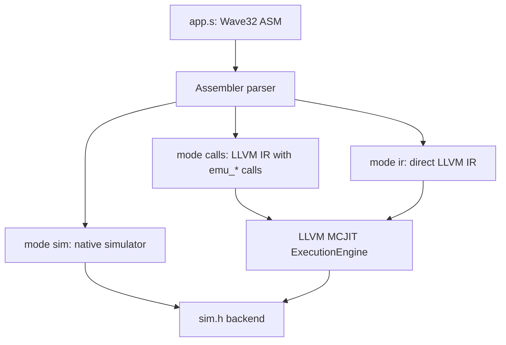

# Wave32 — собственный набор инструкций для Wave-2D

## 1. Обоснование по статистике задания № 2

В качестве исходных данных использованы `../stats/STATS.md`, `../stats/basic_ngrams.csv`,
`../stats/phi_ngrams.csv` и `../app-opt.ll` (оптимизация `clang -O2`).
По трассе из **20 кадров** получено 211 011 418 записей для базовой статистики.
Наиболее частые пары и инструкции:

| Наблюдение | Доля в базовой трассе | Решение в Wave32 |
|---|---:|---|
| `load <- getelementptr` | 12,15 % | `ld`, адрес `base * N + idx` |
| `getelementptr <- getelementptr` | 7,89 % | плоская память из четырёх массивов |
| `add <- load` | 7,22 % | `add` и специализированный `stencil` |
| `getelementptr <- add` | 4,65 % | индексирование через `shl` + `add` |
| `br <- icmp` | 4,19 % | парные инструкции `lt/eq/...` + `br` |
| `icmp <- add` | 4,06 % | сравнения результата арифметики |
| `mul <- select` | 3,51 % | `mul`, `circle`, `shade` |
| `add <- mul` | 3,18 % | `mul`, `add` |

В качестве *предметно-ориентированных составных инструкций* добавлены:

- **`stencil`**: слияние четырёх обращений к соседям, сложения, сдвига,
  вычитания, затухания, маски суши и записи в `prev`;
- **`circle`**: слияние двух разностей, трёх умножений, сложения и сравнения;
- **`shade`**: слияние обращений к соседям, вычисления наклона,
  clamp/compare/select, цветовых компонент и упаковки ARGB.

Это не попытка скопировать IR с заменой мнемоник: ISA включает и обычные
операции, и короткие специализированные инструкции для наиболее частых
последовательностей из конкретной задачи. Все составные инструкции **полностью
раскрываются** в режиме `ir` и имеют программные обработчики в режиме `calls`.

## 2. Архитектура

- Целочисленная регистровая машина: **128 регистров по 32 бита**, имена `%имя`.
  Ассемблер автоматически назначает регистрам физические номера, сначала 0.
- Все скалярные значения, компоненты цветов и буферы — `i32`.
- 4 массива по `N=512×256=131072` значений `i32`:
  `0 = bufA`, `1 = bufB`, `2 = water`, `3 = shown`.
- Состояние: `struct { int32_t reg[128]; int32_t mem[4*N]; }`.
  Массивы и регистры инициализируются нулями перед запуском.
- Адрес `ld/st` задаётся **двумя целочисленными операндами**:
  номером массива `base` и индексом `idx`; фактическое смещение в словах:
  `128 + base*N + idx`. `base` может быть регистром, поэтому перестановка
  `cur`/`prev` делается обычными `mov` без копирования массивов.
- В режиме симуляции `ld/st` проверяют границы, а прямой IR использует GEP
  для корректных индексов (программа гарантирует границы).
- Каждая инструкция — отдельная строка; комментарий начинается с `;`.
- Операнд: регистр `%name` либо непосредственная константа со знаком в
  десятичной или шестнадцатеричной форме (`0xFFFF0000` тоже допустим).
- `i32` арифметика `add/sub/mul` — по модулю 2³²; `div/mod` — знаковые;
  `ashr` — арифметический правый сдвиг, `shl` — левый;
  количество бит сдвига ограничивается `& 31`.
- Результат сравнения — целое `i32` 0 или 1. Для `br` любое ненулевое
  значение считается `true`.
- Переходы только явные: перед каждой новой меткой должен быть `jmp`, `br`
  либо `halt`. Это позволяет напрямую построить корректные LLVM BasicBlock.

## 3. Полный перечень инструкций

Ниже `d` — регистр назначения, `a,b` — регистр/константа,
`base` — номер буфера, `i` — индекс в буфере. У всех инструкций, кроме
`jmp/br/halt`, есть отдельный `emu_<имя>`.

| Инструкция | Семантика | Прямой LLVM IR |
|---|---|---|
| `mov d, a` | `d = a` | `load` или константа + `store` |
| `add d, a, b` | `d = a + b` | `add i32` |
| `sub d, a, b` | `d = a - b` | `sub i32` |
| `mul d, a, b` | `d = a * b` | `mul i32` |
| `div d, a, b` | `d = a / b`, знаковое деление | `sdiv i32` |
| `mod d, a, b` | `d = a % b`, знаковый остаток | `srem i32` |
| `and d, a, b` | побитовое `AND` | `and i32` |
| `or d, a, b` | побитовое `OR` | `or i32` |
| `shl d, a, b` | `a << (b&31)` | `shl i32` |
| `ashr d, a, b` | `a >> (b&31)`, с сохранением знака | `ashr i32` |
| `eq d, a, b` | `a == b` | `icmp eq` + `zext` |
| `ne d, a, b` | `a != b` | `icmp ne` + `zext` |
| `lt d, a, b` | `a < b` (signed) | `icmp slt` + `zext` |
| `le d, a, b` | `a <= b` (signed) | `icmp sle` + `zext` |
| `gt d, a, b` | `a > b` (signed) | `icmp sgt` + `zext` |
| `ge d, a, b` | `a >= b` (signed) | `icmp sge` + `zext` |
| `ld d, base, i` | `d = mem[base][i]` | `getelementptr` + `load` |
| `st base, i, a` | `mem[base][i] = a` | `getelementptr` + `store` |
| `circle d, x, y, cx, cy, r` | внутри открытого круга | `sub/mul/add/icmp/zext` |
| `stencil cur, prev, water, i` | один конечно-разностный шаг с затуханием | `gep/load/add/ashr/sub/and/store` |
| `shade d, cur, i` | освещение воды и цвет `0xAARRGGBB` | `load/arithmetic/icmp/select/or/shl` |
| `rand d` | `d = simRand()` | `call i32 @simRand()` + `store` |
| `pixel x, y, color` | вывод пикселя | `call void @simPutPixel(...)` |
| `flush` | завершение кадра | `call void @simFlush()` |
| `jmp label` | безусловный переход | `br label` |
| `br cond, yes, no` | переход по условию | `icmp ne 0` + `br i1` |
| `halt` | выход из программы | `ret void` |

Всего **27 мнемоник**, из них **24 не являются инструкциями потока управления**
(включая три инструкции внешнего интерфейса). `rand/pixel/flush` — обращения
к устройствам/системному окружению, а не к C-реализации вычислительного
алгоритма. Поэтому в *полностью генерируемом IR* они остаются вызовами
`simRand`, `simPutPixel`, `simFlush` — точно так же, как в исходном `app.c`.

### `circle`

```text
circle dst, x, y, cx, cy, radius

dx = x - cx
dy = y - cy
dst = ((dx*dx + dy*dy) < radius*radius) ? 1 : 0
```

Соответствует вычислению островов и метки движущегося источника
`isInsideCircle`.

### `stencil`

```text
stencil cur, prev, water, i

v = ((cur[i-1] + cur[i+1] + cur[i-512] + cur[i+512]) >> 1)
    - prev[i]
v = v - (v >> 6)
prev[i] = v & water[i]
```

Это точное содержание `waveStep` из `../app.c`; рамка не затрагивается.
Шаг реализован на **старом** `cur`, запись идёт в `prev`. После прохода
двухслойные буферы меняются местами в ASM.

### `shade`

```text
shade color, cur, i

slope = (cur[i-1] - cur[i+1]) + (cur[i-512] - cur[i+512])
s = clamp255(90 + (slope >> 2) + (cur[i] >> 4))
r = (s*s*s) >> 16
g = clamp255(30 + ((s*s) >> 8))
b = clamp255(80 + s)
color = 0xFF000000 | (r<<16) | (g<<8) | b
```

Значение `shade` рассчитывается только для воды: граничные клетки
используют песочный цвет и не читают соседей вне массива.

## 4. Пример ASM

```asm
start:
  mov %cur, 0
  mov %prev, 1
  mov %water, 2
  mov %i, 513
  st %water, %i, -1
  stencil %cur, %prev, %water, %i
  ld %value, %prev, %i
  lt %positive, 0, %value
  br %positive, is_positive, is_nonpositive
is_positive:
  pixel 0, 0, 0xFF00FF00
  jmp done
is_nonpositive:
  pixel 0, 0, 0xFFFF0000
done:
  flush
  halt
```

Полная программа: [`app.s`](app.s), 306 строк, содержит самостоятельно:
маску бассейна и острова, оба вложенных цикла `addDrop`, цикл
`waveStep`, вращение источника, дождь, цвет воды, сравнение с `shown`,
масштабирование каждой изменившейся клетки на 3×3 пикселя и выдачу кадра.

## 5. Способы исполнения одной ASM-программы



1. **`--mode sim` (5*)**: цикл по индексу программы, выполнение арифметических
   команд в C++ и переходы по таблице меток, LLVM IR не генерируется.
2. **`--mode calls` (3)**: генерируется LLVM-модуль из BasicBlock, `br` и
   **отдельных внешних вызовов `@emu_mov`, `@emu_stencil`, `@emu_shade`, ...**
   для каждой неуправляющей ASM-инструкции. Адреса эмуляторов привязываются
   через `LLVMAddGlobalMapping`; запуск через LLVM `ExecutionEngine` (MCJIT).
3. **`--mode ir` (4)**: прямое поинструкционное раскрытие в арифметику,
   сравнения, GEP, load/store, select и br. Генерируемый модуль **не содержит
   `@emu_*`**. Вызовы остаются только для интерфейса графики/ГСЧ.

В обоих LLVM-режимах выполняется `LLVMVerifyModule`. Генератор реализован
на стабильном **LLVM C API**, хотя сам `asm2ir.cpp` написан на C++17.
При наличии пакета `llvm-dev` используется системный `llvm-c/*.h`; при
наличии только libLLVM 19 на Linux — вложенные объявления минимального
нужного набора LLVM C API в `llvm_c_api.h`.

## 6. Проверка и эквивалентность

Команда `make -C asm2ir test` сравнивает хеш всей последовательности вызовов
`simPutPixel(x,y,argb)` для исходной `app.c` и трёх режимов ASM2IR.
Проверяется **порядок**, все координаты и значения цветов, а не только
финальная картинка. ГСЧ инициализируется фиксированным `srand(12345)`.

Контроль на Linux (Clang, LLVM 19, 20 кадров):

| Реализация | Пикселей | FNV64 |
|---|---:|---|
| Исходная C (`app.c`) | 1 521 207 | `ee84759a26cfa9d6` |
| Wave32 simulator | 1 521 207 | `ee84759a26cfa9d6` |
| ASM→IR calls + MCJIT | 1 521 207 | `ee84759a26cfa9d6` |
| ASM→IR pure + MCJIT | 1 521 207 | `ee84759a26cfa9d6` |

**Важная тонкость C:** в исходном вызове `addDrop(cur, 1+simRand()%..., 1+simRand()%..., ...)`
порядок вычисления аргументов не определён стандартом C. Используется
**Clang**, как и в исходном `../Makefile` и `../app-opt.ll`. GCC может
переставить два вызова `simRand` и выдать *другую* случайную картинку,
хотя алгоритм не изменится. Именно поэтому проверка исходника должна
собираться Clang, а не случайным `cc`.

Также имеется ISA-smoke-тест `tests/isa_smoke.s`: проверяет все обычные
целочисленные операции, сравнения, память и составные `circle/stencil/shade`.

## 7. Ограничения

- Конфигурация 512×256 и четыре массива преднамеренно фиксированы для
  **именно этого** приложения; это не компилятор произвольного C.
- Для исполнения LLVM-режимов нужен LLVM `ExecutionEngine/MCJIT` с нативным
  целевым бэкендом x86-64 или AArch64.
- Нет универсального распределителя памяти, исключений языка или
  проверок выхода за массив непосредственно в чистом IR.
- Поведение арифметики на корректных данных Wave-2D эквивалентно исходному C.
  Деление на ноль, выход за массив или переполнение `INT_MIN / -1`
  не входят в допустимые программы ISA.
